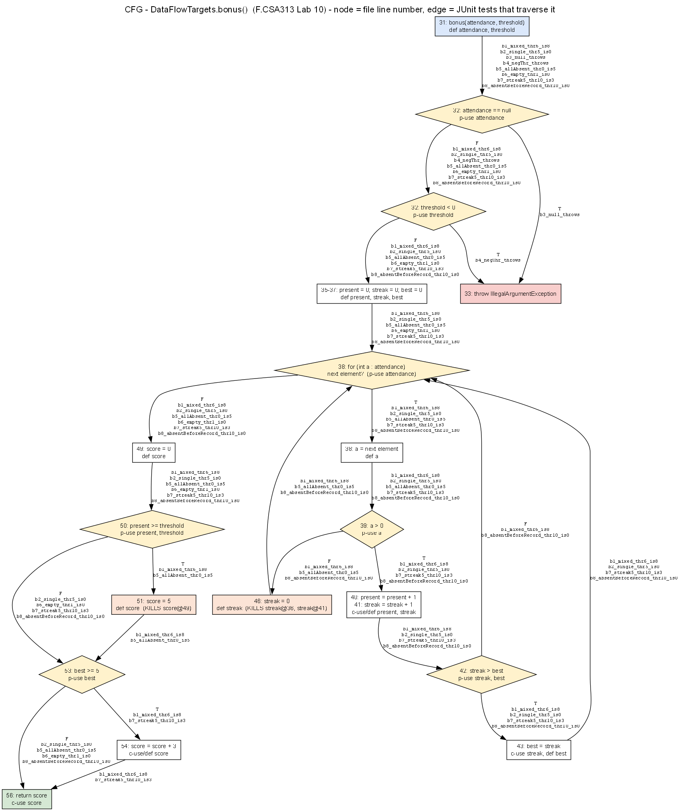

# Лаборатори №10: Өгөгдлийн урсгалын тест — Definition-Use хосууд

**Оюутан:** Х.Түмэн-Амгалан
**Код:** B232270063
**Хичээл:** F.CSA313 — Программ хангамжийн чанарын баталгаа ба тест (2026)

## Орчин

```
$ java -version
openjdk version "17.0.20.1" 2026-08-18
OpenJDK Runtime Environment Temurin-17.0.20.1+1 (build 17.0.20.1+1)
OpenJDK 64-Bit Server VM Temurin-17.0.20.1+1 (build 17.0.20.1+1, mixed mode, sharing)

$ mvn -version
Apache Maven 3.9.9 (8e8579a9e76f7d015ee5ec7bfcdc97d260186937)
Maven home: C:\Users\tumee\tools\apache-maven-3.9.9
Java version: 17.0.20.1, vendor: Eclipse Adoptium, runtime: C:\Program Files\Eclipse Adoptium\jdk-17.0.20.101-hotspot
Default locale: en_US, platform encoding: Cp1252
OS name: "windows 11", version: "10.0", arch: "amd64", family: "windows"
```

> Эх сурвалж: [`results/versions.txt`](results/versions.txt). `DataFlowTargets.java`, `pom.xml`,
> `.gitignore` нь багшийн starter-тэй байт бүрээр ижил (Starter commit-оос хойш `src/main`
> өөрчлөгдөөгүй). Бүх мөрийн дугаар нь `DataFlowTargets.java` файлын мөр.

## Тест ба хамралтын явц (`results/`-ээс)

| Үе шат | `Tests run` | Branch | Line | Файл |
|---|---:|---:|---:|---|
| B all-defs (gcd 3 + bonus 2) | 5 | 14/16 | 22/24 | `mvn-verify-alldefs.txt`, `jacoco-alldefs.csv` |
| B all-DU-pairs (gcd 3 + bonus 7) | 10 | 16/16 | 23/24 | `mvn-verify-alldupairs.txt`, `jacoco-alldupairs.csv` |
| *(туршилт)* branch 100% хүрэх дэд олонлог | 7 | 16/16 | 23/24 | `mvn-verify-branchonly.txt`, `jacoco-branchonly.csv` |
| **Эцсийн** (+ M2-ийг унагах b8) | **11** | **16/16** (`BRANCH_MISSED = 0`) | 23/24 (`LINE_MISSED = 1`) | `mvn-verify-final.txt`, `jacoco-final.csv` |

`LINE_MISSED = 1` нь 7-р мөр — Java-гийн далд constructor `DataFlowTargets()`; зааврын дагуу
түүнийг хамруулах тест бичээгүй, кодыг өөрчлөөгүй.

---

## Хэсэг A: gcd — бүрэн DU хүснэгт

Мөрүүд: **13** def `x`, `y` (параметр) · **14** `int tmp;` — зөвхөн зарлалт, утга оноогоогүй тул
**def биш** · **15** `while (y != 0)` p-use `y` · **16** `tmp = x % y` (c-use `x`, `y`; def `tmp`) ·
**17** `x = y` (c-use `y`; def `x`) · **18** `y = tmp` (c-use `tmp`; def `y`) · **20** `return x` (c-use `x`).
p-use-ийг салаа бүрээр (15T — давталтад орох, 15F — гарах) тусад нь тоолсон.

| # | Хувьсагч | Def мөр | Use мөр | Төрөл | Def-clear зам | Тестийн ID | Хамрагдсан |
|---|---|---|---|---|---|---|---|
| 1 | x | 13 | 16 | c-use | 13→14→15(T)→16 | G2, G3 | ✓ |
| 2 | x | 13 | 20 | c-use | 13→14→15(F)→20 | **G1** | ✓ |
| 3 | x | 17 | 16 | c-use | 17→18→15(T)→16 (2 дахь давталт) | G2 | ✓ |
| 4 | x | 17 | 20 | c-use | 17→18→15(F)→20 | G2, G3 | ✓ |
| 5 | y | 13 | 15T | p-use | 13→14→15(T) | G2, G3 | ✓ |
| 6 | y | 13 | 15F | p-use | 13→14→15(F) | **G1** | ✓ |
| 7 | y | 13 | 16 | c-use | 13→14→15(T)→16 | G2, G3 | ✓ |
| 8 | y | 13 | 17 | c-use | 13→14→15(T)→16→17 | G2, G3 | ✓ |
| 9 | y | 18 | 15T | p-use | 18→15(T) | G2 | ✓ |
| 10 | y | 18 | 15F | p-use | 18→15(F) | G2, G3 | ✓ |
| 11 | y | 18 | 16 | c-use | 18→15(T)→16 | G2 | ✓ |
| 12 | y | 18 | 17 | c-use | 18→15(T)→16→17 | G2 | ✓ |
| 13 | tmp | 16 | 18 | c-use | 16→17→18 | G2, G3 | ✓ |

**Нийт 13 хос, 13/13 хамрагдсан** (x — 4, y — 8, tmp — 1). Лекцийн хүснэгтэд ихэвчлэн орхигддог
хосууд: давталтаас **буцаж ирсэн** def-үүдийн хос (#3 `x`17→16, #9–#12 `y`18→…) ба давталтад огт
ороогүй үеийн хос (#2, #6).

**Тестүүд** (`GcdTest.java`, `@DisplayName`-д хамарч буй хосыг мөрийн дугаараар бичсэн):

| ID | Метод | Оролт → гаралт | Давталт |
|---|---|---|---|
| G1 | `g1_gcd7_0_is7` | gcd(7, 0) = 7 | 0 |
| G2 | `g2_gcd12_8_is4` | gcd(12, 8) = 4 | 2 (12%8=4 → 8%4=0) |
| G3 | `g3_gcd0_5_is5` | gcd(0, 5) = 5 | 1 |

- **gcd(7,0) ГАНЦААРАА хамардаг хос:** `x`(13→20) ба `y`(13→15F) — `y = 0` тул давталтад огт
  орохгүй; энэ хоёр хос бусад ямар ч (давталттай) тестэд хамрагдахгүй.
- **gcd(12,8) хэдэн давталт:** **2**. Давталт **2+** шаарддаг хосууд: `x`(17→16), `y`(18→15T),
  `y`(18→16), `y`(18→17) — эдгээр нь 17/18-д тодорхойлогдоод *дараагийн* давталтад ашиглагдана.
  G3 (1 давталт) эдгээрийг хамарч чадахгүй, тиймээс G1 + G2 нь all-DU-pairs-ийг хангана.

---

## Хэсэг B: bonus — бүрэн анализ

### B1 — CFG



Зангилаа бүр файлын мөрийн дугаартай; ирмэг бүрт түүнийг дайрдаг тестийн бодит метод нэр
бичигдсэн. For-each давталт (мөр 38) хоёр зангилаа: нөхцөл «дараагийн элемент бий юу?»
(`attendance`-ийн p-use) ба алхам «a = дараагийн элемент» (`a`-ийн def). Улбар шар зангилаа нь
def-ийг устгадаг (kill) мөрүүд. Graphviz-ээр зурсан — эх нь [`cfg-bonus.dot`](cfg-bonus.dot).

### B2 — Мөр бүрийн def / use

```java
31: bonus(int[] attendance, int threshold)    // def: attendance, threshold
32: if (attendance == null || threshold < 0)   // p-use: attendance; p-use: threshold (attendance != null үед л)
33:   throw new IllegalArgumentException(...)   // —
35: int present = 0;                           // def: present
36: int streak = 0;                            // def: streak
37: int best = 0;                              // def: best
38: for (int a : attendance)                   // p-use: attendance (дараагийн элемент бий юу); def: a
39:   if (a > 0)                               // p-use: a
40:     present = present + 1;                 // c-use: present; def: present
41:     streak = streak + 1;                   // c-use: streak; def: streak
42:     if (streak > best)                     // p-use: streak, best
43:       best = streak;                       // c-use: streak; def: best
46:     streak = 0;                            // def: streak   (KILL: streak@36, streak@41)
49: int score = 0;                             // def: score
50: if (present >= threshold)                  // p-use: present, threshold
51:   score = 5;                               // def: score    (KILL: score@49)
53: if (best >= 5)                             // p-use: best
54:   score = score + 3;                       // c-use: score; def: score
56: return score;                              // c-use: score
```

Нийт **13 def**: attendance@31, threshold@31, present@35, present@40, streak@36, streak@41,
streak@46, best@37, best@43, a@38, score@49, score@51, score@54.

### B3 — DU хүснэгт

| # | Хувьсагч | Def | Use | Төрөл | Def-clear зам (товч) | Тестийн ID |
|---|---|---|---|---|---|---|
| 1 | attendance | 31 | 32T | p | 31→32 (`null`) | b3 |
| 2 | attendance | 31 | 32F | p | 31→32 | b1, b2, b4, b5, b6, b7, b8 |
| 3 | attendance | 31 | 38T | p | 31→…→38 (элемент бий) | b1, b2, b5, b7, b8 |
| 4 | attendance | 31 | 38F | p | 31→…→38 (дууссан / хоосон) | b1, b2, b5, b6, b7, b8 |
| 5 | threshold | 31 | 32T | p | 31→32 (`attendance != null`, `< 0`) | b4 |
| 6 | threshold | 31 | 32F | p | 31→32 | b1, b2, b5, b6, b7, b8 |
| 7 | threshold | 31 | 50T | p | 31→…→50 | b1, b5 |
| 8 | threshold | 31 | 50F | p | 31→…→50 | b2, b6, b7, b8 |
| 9 | present | 35 | 40 | c | 35→38→39(T)→40 (анхны ирсэн өдөр) | b1, b2, b7, b8 |
| 10 | present | 35 | 50T | p | 35→38(F)→49→50, ирсэн өдөргүй, thr = 0 | b5 |
| 11 | present | 35 | 50F | p | 35→38(F)→49→50, ирсэн өдөргүй, thr > 0 | b6 |
| 12 | present | 40 | 40 | c | 40→…→38→39(T)→40 (2+ ирсэн өдөр) | b1, b7, b8 |
| 13 | present | 40 | 50T | p | 40→…→38(F)→49→50 | b1 |
| 14 | present | 40 | 50F | p | 40→…→38(F)→49→50 | b2, b7, b8 |
| 15 | streak | 36 | 41 | c | 36→38→39(T)→40→41 (**эхний** элемент ирсэн) | b1, b2, b7, b8 |
| 16 | streak | 41 | 41 | c | 41→42→(43)→38→39(T)→40→41 (**дараалсан** ирц) | b1, b7, b8 |
| 17 | streak | 41 | 42T | p | 41→42 | b1, b2, b7, b8 |
| 18 | streak | 41 | 42F | p | 41→42 | b1, b8 |
| 19 | streak | 41 | 43 | c | 41→42(T)→43 | b1, b2, b7, b8 |
| 20 | streak | 46 | 41 | c | 46→38→39(T)→40→41 (тасалсны дараа ирсэн) | b1, b8 |
| 21 | best | 37 | 42T | p | 37→…→42 (анхны ирсэн өдөр) | b1, b2, b7, b8 |
| 22 | best | 37 | 42F | p | — | **биелэшгүй** |
| 23 | best | 37 | 53T | p | — | **биелэшгүй** |
| 24 | best | 37 | 53F | p | 37→38(F)→49→…→53, ирсэн өдөргүй | b5, b6 |
| 25 | best | 43 | 42T | p | 43→38→39(T)→40→41→42 | b1, b7, b8 |
| 26 | best | 43 | 42F | p | 43→…→42 (шинэ цуваа рекордоос бага) | b1, b8 |
| 27 | best | 43 | 53T | p | 43→…→38(F)→…→53 (best ≥ 5) | b1, b7 |
| 28 | best | 43 | 53F | p | 43→…→38(F)→…→53 (best < 5) | b2, b8 |
| 29 | a | 38 | 39T | p | 38→39 | b1, b2, b7, b8 |
| 30 | a | 38 | 39F | p | 38→39 | b1, b5, b8 |
| 31 | score | 49 | 54 | c | 49→50(F)→53(T)→54 | b7 |
| 32 | score | 49 | 56 | c | 49→50(F)→53(F)→56 | b2, b6, b8 |
| 33 | score | 51 | 54 | c | 51→53(T)→54 | b1 |
| 34 | score | 51 | 56 | c | 51→53(F)→56 | b5 |
| 35 | score | 54 | 56 | c | 54→56 | b1, b7 |

**35 хослолоос 2 биелэшгүй, 33 биелэх хос; 33/33 хамрагдсан.**

**Биелэшгүй хосын үндэслэл:**
- **#22 best(37→42F):** 37-ийн `best = 0` 42-д хүрэх үед 41-д `streak` дор хаяж 1 болсон байдаг тул
  `streak > best` (≥ 1 > 0) үргэлж **үнэн** — best@37-тай F салаа боломжгүй.
- **#23 best(37→53T):** best@37 53-д def-clear хүрэх нь 43 огт ажиллаагүй (ирсэн өдөр байхгүй)
  үед л боломжтой, тэгвэл `best = 0` тул `best >= 5` үргэлж **худал**.

**Kill (дахин тодорхойлолт) — def-clear зам тасардаг газрууд:**
- **46 `streak = 0`** нь streak@36 ба streak@41-ийг **устгадаг**: тасалсан өдрийн дараа 41-д ирэх
  `streak`-ийн утга нь 46-ийнх (#20), 36/41-ийнх биш. Иймд (#15) зөвхөн эхний элемент ирсэн үед,
  (#16) зөвхөн дараалсан ирсэн өдрүүдэд def-clear.
- **41 `streak = streak + 1`** нь streak@36 ба streak@46-ийг 42/43 хүрэхээс **өмнө** үргэлж
  устгадаг тул **streak(36→42), streak(36→43), streak(46→42), streak(46→43) нь DU хос БИШ** —
  def-clear зам огт байхгүй (хүснэгтэд оруулаагүй).
- **51 `score = 5`** нь score@49-ийг устгадаг: 50(T) замаар score@49 нь 54/56-д хүрэхгүй, иймд
  #31, #32 нь зөвхөн 50(F) замаар def-clear.
- **54 `score = score + 3`** нь score@49/51-ийг 56-аас өмнө устгадаг: #32, #34 нь зөвхөн 53(F)-ээр.

> Хүснэгтийг гараар гаргасны дараа `bonus()`-ийг мөр бүрээр нь дуурайлгасан Python tracer-ээр
> (def/use үйл явдлыг бүртгэдэг) **25,000+ оролт** дээр давхар шалгасан: биелэх хос яг 33,
> #22/#23 нэг ч оролтод гараагүй, тест бүрийн ID нь tracer-ийн гаргасантай таарсан.

### B4 — Хоёр шатны тестүүд (`BonusTest.java`)

| ID | Метод | Оролт → гаралт | Шат |
|---|---|---|---|
| b1 | `b1_mixed_thr6_is8` | [1,1,1,1,1,0,1], thr=6 → 8 (яг threshold) | all-defs |
| b2 | `b2_single_thr5_is0` | [1], thr=5 → 0 | all-defs |
| b3 | `b3_null_throws` | null, 1 → IAE | all-DU-pairs |
| b4 | `b4_negThr_throws` | [1], −1 → IAE | all-DU-pairs |
| b5 | `b5_allAbsent_thr0_is5` | [0,0], thr=0 → 5 (бүгд тасалсан, threshold = 0) | all-DU-pairs |
| b6 | `b6_empty_thr1_is0` | [], thr=1 → 0 (хоосон массив) | all-DU-pairs |
| b7 | `b7_streak5_thr10_is3` | [1,1,1,1,1], thr=10 → 3 (threshold-гүй +3) | all-DU-pairs |
| b8 | `b8_absentBeforeRecord_thr10_is0` | [1,0,1,1,1,1], thr=10 → 0 | Хэсэг C (M2-ийг унагах) |

**ALL-DEFS — хамгийн цөөндөө 2 тест (b1, b2).** 13 def бүр нэг use-д хүрэх ёстой. **score@49**
нь зөвхөн `present < threshold` (50F) үед use-д (54/56) хүрнэ — 50T бол 51 түүнийг устгана;
**score@51** нь зөвхөн 50T үед үүснэ. Нэг гүйцэтгэлд 50-ийн салаа нэг л байх тул score@49 ба
score@51 хоёулаа use-д хүрэх ганц тест **байхгүй** (tracer-ээр 8 хүртэлх урттай бүх 0/1 массив,
threshold 0–9-ийг бүгдийг шалгаж баталсан). b1 нь бусад 12 def-ийг (streak@46 — тасалсны дараа
ирсэн өдөр, best@43 — 5 цуваа, score@51, score@54 г.м.) хамарч, b2 нь score@49-ийг хамарна.

`results/jacoco-alldefs.csv`: **Branch 14/16, Line 22/24** (`Tests run: 5`). **All-defs хангагдсан ч
branch 100% биш** — 32-р мөрийн `attendance == null` ба `threshold < 0`-ийн **үнэн** салаа (exception)
хамрагдаагүй: тэр замд ямар ч def байхгүй тул all-defs түүнийг шаарддаггүй.

**ALL-DU-PAIRS — b1…b7 (+ gcd 3) = 10 тест:** 33/33 хос хамрагдсан; `results/jacoco-alldupairs.csv`:
Branch 16/16, Line 23/24.

### B5 — Branch vs DU: branch 100% байхад DU хос үлдэх үү?

**Тийм.** gcd-ийн 3 тест + b1–b4 (нийт **7 тест**) ажиллуулахад **Branch 16/16** болсон
(`results/jacoco-branchonly.csv`, `mvn-verify-branchonly.txt`: `Tests run: 7`) — гэвч tracer-ээр
шалгахад bonus-ийн 33 хосоос **5 нь хамрагдаагүй** хэвээр:

| Хамрагдаагүй хос | Яагаад branch-д харагдахгүй |
|---|---|
| score(49→54) | 50F ба 53T салаа тус бүрдээ хамрагдсан, гэхдээ **хамтдаа** (threshold хангаагүй ч +3) нэг гүйцэтгэлд ороогүй |
| score(51→56) | 50T ба 53F тус бүрдээ, гэхдээ хамтдаа биш |
| present(35→50T), present(35→50F) | 50-ийн хоёр салаа хамрагдсан, гэхдээ **ирсэн өдөргүй** (present@35 амьд) үед биш |
| best(37→53F) | 53F хамрагдсан, гэхдээ best@43 үүсээгүй (ирсэн өдөргүй) үед биш |

Branch хамралт нь салаа бүрийг **дангаар нь** тоолдог бол DU хос нь **аль def аль салаанд** хүрснийг
(салаануудын хослол, утгын эх сурвалж) шаарддаг — иймд branch 100% нь DU-ийн бүрэн байдлын баталгаа биш.

---

## Хэсэг C: Fault seeding

Мутаци бүрийг `DataFlowTargets.java` дээр шууд хийж, `mvn test` ажиллуулж, дараа нь эх хувилбараар
(Starter-тэй байт бүрээр ижил) буцаасан. Мутацийг commit хийгээгүй.

| № | Мутаци | Төрөл | Үр дүн (b1–b7 + gcd, 10 тест) | Унасан тест / мөр | Файл |
|---|---|---|---|---|---|
| M1 | 41-р мөр `streak = streak + 1;` устгасан | Missing update | **Баригдсан** — Failures: 2 | `b1_mixed_thr6_is8`: `expected: <8> but was: <5>`; `b7_streak5_thr10_is3`: `expected: <3> but was: <0>` | [`mvn-test-M1.txt`](results/mvn-test-M1.txt) |
| M2 | 43-р мөр `best = streak;` → `best = present;` | Wrong variable | **АМЬД** — Failures: 0, BUILD SUCCESS | — | [`mvn-test-M2.txt`](results/mvn-test-M2.txt) |
| M2 + b8 | ижил мутаци, b8 нэмсний дараа (11 тест) | | **Баригдсан** — Failures: 1 | `b8_absentBeforeRecord_thr10_is0`: `expected: <0> but was: <3>` | [`mvn-test-M2-kill.txt`](results/mvn-test-M2-kill.txt) |
| M3 | давталтын дараа `int total = present + best;` | Dead definition | **АМЬД** — Failures: 0, BUILD SUCCESS | — | [`mvn-test-M3.txt`](results/mvn-test-M3.txt) |

### M2 яагаад all-DU-pairs-ийг давж амьд үлдсэн бэ

M2-ийн мутацитай мөр (43) ба best-ийн бүх хос (#25–#28) хамрагдсан ч, b1–b7-ийн аль алинд нь
`best` шинэчлэгдэх **мөч бүрд `present == streak`** байсан: тасалсан өдөр (b1-д) рекорд цувааны
**дараа** л гарсан, бусад тестэд огт тасалдаагүй. Тиймээс `best = streak` ба `best = present`
яг **ижил утга** өгч, тест ялгааг харах боломжгүй байсан — хос *хамрагдсан* нь хос *ялгаж
шалгагдсан* гэсэн үг биш. **b8** `[1,0,1,1,1,1]` нь тасалсан өдрийг рекордын **өмнө** тавьдаг:
бодит best = 4 (< 5) → 0 оноо, мутант best = present = 5 → +3 → **3** гэж буруу гарч баригдсан.
Мутацийг буцаасны дараа b8 эх код дээр ногоон.

### M3 яагаад ямар ч тест унагадаггүй вэ

`total` хаана ч ашиглагдахгүй тул програмын гаралтад нөлөөгүй — тест зөвхөн **ажиглагдах зан
төлөвийг** шалгадаг тул үхсэн def-ийг хэзээ ч барьж чадахгүй. `javac -Xlint:all` ч анхааруулга
өгөхгүй. Үүнийг **статик анализ** барина — VS Code-ийн Java (Eclipse JDT) хөрвүүлэгч мутант дээр
шууд анхааруулсан ([`results/M3-static-analysis.txt`](results/M3-static-analysis.txt)):

```
1. WARNING in ...\DataFlowTargets.java (at line 49)
	int total = present + best;
	    ^^^^^
The value of the local variable total is not used
```

Дуусахад `src/main` нь Starter-тэй ижил, `results/mvn-verify-final.txt`: `Tests run: 11, Failures: 0`,
`results/jacoco-final.csv`: `BRANCH_MISSED = 0` (16/16), `LINE_MISSED = 1` (7-р мөр).

---

## Дүгнэлт

DU анализ нь branch хамралтаас илүү, учир нь branch нь салаа бүрийг дангаар нь тоолдог бол DU
нь **утга хаанаас ирж хаана хэрэглэгдэж байгааг** — тодорхойлолт ба хэрэглээг холбосон замыг —
шаарддаг: энэ лабд branch 16/16 хүрсэн 7 тест bonus-ийн 33 хосоос 5-ыг хамраагүй, жишээ нь
«threshold хангаагүй ч +3 авах» score(49→54) хослолыг огт туршаагүй байв. Эсрэгээрээ all-defs
хангагдсан ч (Branch 14/16) branch 100% биш байсан нь хоёр шалгуур бие биеэ орлохгүй, нөхдөг
гэдгийг харуулсан. Гэхдээ M2 нь DU-ийн хязгаарыг тодорхой харуулсан: бүх 33 хос хамрагдсан атлаа
`best = present` гэсэн буруу хувьсагчийг барьж чадаагүй, учир нь хос бүрийг дайрсан утгууд нь
(`present == streak`) хоёр хувьсагчийг ялгах боломжгүй байв — хамралт нь «зам дайрсан» эсэхийг,
харин тестийн утга алдааг илрүүлэх хангалттай «ялгаатай» эсэхийг хэмждэггүй. M3-ийн үхсэн def-ийг
ямар ч динамик тест барьж чадахгүй, зөвхөн статик анализ (Eclipse JDT) барьсан. DU анализын үнэ нь
өндөр: JaCoCo үүнийг хэмждэггүй тул бүх def/use, kill, биелэшгүй хосыг гараар гаргах шаардлагатай
бөгөөд мөрийн дугаар, def-clear зам бүрийг шалгахад цаг их зарцуулсан. Хамгийн их цаг авсан алхам
нь **B3 — DU хүснэгт**: 46 ба 41-ийн kill-ээс болж аль хослол DU хос огт биш, аль нь биелэшгүй
(#22, #23) болохыг тогтоох нь хамгийн нарийн байсан тул tracer-ээр давхар шалгасан.

---

## AI туслахын хэрэглээ

Энэ лабд **Claude Code (AI туслах)**-ыг ашигласан: DU хүснэгтийг шалгах Python
tracer бичих, JUnit тестүүд бичих, мутацийн туршилт ба JaCoCo-гийн тоог задлах, `cfg-bonus.dot`-ийг
үүсгэж Graphviz-ээр `cfg-bonus.png` болгох, README-ийн текстийг бичихэд. Бүх тоог `results/` доторх
бодит гаралтаас, CFG ба хүснэгт дээрх тестийн нэр бүрийг тестийн файлаас шалгаж оруулсан.

Харин DU хүснэгтийг гараар гаргасан
